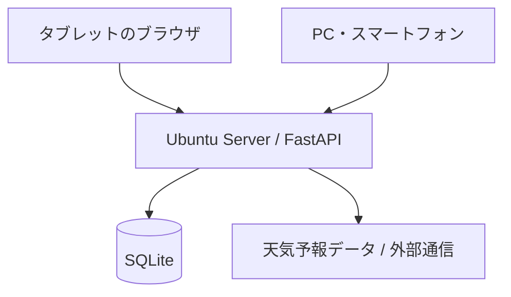

## このシリーズの記事

- [第1回：UbuntuとPythonでオフィスの点検・在席管理システムを自作した](https://zenn.dev/techcraft-lab/articles/office-terminal-01-introduction) **（この記事）**
- [第2回：余っていたPCとRaspberry Piで作るオフィス管理システム](https://zenn.dev/techcraft-lab/articles/office-terminal-02-system-architecture)
- [第3回：オフィス管理システムの中身を見てみる。FastAPIとSQLiteの設計](https://zenn.dev/techcraft-lab/articles/office-terminal-03-web-application)

## はじめに

事務所の退室点検と社員の在席状況を管理するWebアプリケーション「**office_terminal**」を作りました。

Ubuntu Server上でPythonのFastAPIを動かし、タブレットやPCのブラウザから操作する構成です。最初は退室点検簿の電子化が目的でしたが、在席管理や履歴、カレンダーなども追加しました。

もう一つの目的は、**若手エンジニアの開発教育**です。まず自分で最低限動作する骨格を用意し、今後の操作性改善やハードウェア連携は、若手社員が設計・実装する題材にもしたいと考えています。

この記事では、現在の構成と実装済みの機能、残している課題や拡張アイデアを紹介します。詳細な実装方法は今後の記事で取り上げる予定です。

## 開発の背景

事務所を最後に退室する際には、エアコン、窓の施錠、照明、電気機器、残留者などの確認が必要です。

毎日の点検を簡単に記録し、後から確認できるようにしたい。また、誰が出社・離席しているかも一目で確認できると便利そうです。そこで、次の方針で作り始めました。

- タッチ操作を中心とし、文字入力をできるだけ減らす
- 小規模な環境で管理しやすい構成にする
- ネットワーク内のPC・スマートフォンからも利用できるようにする
- 後から新しい入力方法や機能を追加できるようにする

「完成品を最初から作り切る」のではなく、**基本機能が動くところまで作り、改善の余地を残す**ことも意識しています。

## システム構成

主な技術構成は以下のとおりです。

| 項目 | 技術 |
| --- | --- |
| OS | Ubuntu Server 24.04 LTS |
| 言語 | Python 3.11 |
| Webアプリ | FastAPI / Jinja2 |
| 画面 | HTML / CSS / JavaScript |
| データベース | SQLite |
| 環境管理 | uv |
| 開発 | VS Code / SSH / GitHub |
| 操作端末 | タブレット・PC・スマートフォン |

小規模なシステムなので、別のDBサーバーを立てずに使えるSQLiteを選びました。ブラウザから利用する構成にしたことで、表示端末を変更してもアプリ本体を大幅に作り直さずに済みます。

## 現在動いている画面と機能

### TOP画面

TOP画面には、時刻・カレンダー・出社者一覧・天気情報をまとめています。点検記録がある日や出社記録のある日をマークで確認でき、在席者一覧は定期的に更新します。

天気情報には外部通信を使用します。通信できない環境では「天気情報を取得できません」と表示されますが、点検や在席管理は利用できます。

### 退室点検

点検するのはエアコン、窓、電灯、電気機器、全員退室の5項目です。点検者を選び、それぞれの結果をボタンで入力します。

「異常あり」「未実施」の場合は、項目に応じた理由の選択が必要です。途中まで入力した内容はブラウザに下書き保存され、再開できるようにしています。

### 出社・在席管理

社員を選択して「出社」「離席」「戻り」「退勤」を記録します。状態変更はSQLiteに保存し、TOP画面の在席表示にも反映します。

現在は**社員を画面で選択する方式で、本人認証はありません**。カードリーダーなどの入力方法を後から追加する想定です。

### 履歴

点検履歴と在席履歴は別々に確認できます。在席履歴では日付や社員で絞り込めます。記録時刻はサーバーで保存した時刻であり、実際に扉を通過した時刻を検出しているわけではありません。

### メニュー

共用端末から操作しやすいよう、主要機能への入り口を大きなボタンにまとめました。社内LAN向けの接続先表示機能も用意していますが、ローカル限定起動中はPC・スマートフォン向けの接続先を表示しません。

## 実装済みの範囲

| 機能 | 状態 |
| --- | --- |
| 退室点検と履歴 | 実装済み |
| 出社・離席・戻り・退勤 | 実装済み |
| 在席一覧とカレンダー | 実装済み |
| PC・スマートフォンからの操作 | 実装済み（LAN設定が必要） |
| 社員のCSV登録 | 実装済み |
| 天気情報 | 実装済み（外部通信を使用） |
| 点検の下書き保存 | 実装済み |
| バックアップ・復元 | オプション（初期状態は無効） |

公開用のコードはUbuntu/Linux環境で既存の自動テスト**162件が成功**しています。ただし、テスト成功がすべての利用環境での動作やセキュリティを保証するものではありません。

## 今後の課題・拡張構想

ここから先は、**まだ実装していない機能や改善アイデア**です。

**ICカードによる出退勤**

USBカードリーダーで社員証を読み、カードの識別子と社員データを対応付けて出退勤を記録する構想です。既存の在席管理処理を活用できれば、USB機器との通信からDB更新まで一通り学べる課題になります。カードの識別子だけでは強固な本人認証にはならないため、利用目的に応じた検討が必要です。

**社員管理Web画面**

現在のCSV登録をブラウザ操作へ広げるアイデアです。入力検証やデータ更新、権限設計を学べそうです。

**顔認証・人感センサー連携**

カメラやセンサーを組み合わせれば、出退勤操作の自動化や画面の省電力制御も考えられます。精度、プライバシー、ハードウェアの取り扱いまで含めて検討が必要です。

**UI改善**

画面サイズごとの調整、操作回数の削減、表示内容の整理など、実際に使いながら改善できる余地があります。

こうした課題を、若手社員が要件整理・実装・テスト・コードレビューまで経験する題材にしていくつもりです。

## ソースコード

GitHubで公開しています。

**[techcraft-lab/office_terminal](https://github.com/techcraft-lab/office_terminal)**

基本機能は動きますが、製品として完成させたものではありません。興味があれば、用途に合わせて改造してもらえればと思います。利用・再配布の条件はリポジトリのLICENSEを確認してください。

なお、ログインや本人認証、厳密な権限制御は実装していません。**インターネットへ直接公開する用途には適していません**。LAN内で利用する場合も、接続範囲と扱うデータには注意が必要です。

## おわりに

最初は小さな点検簿のつもりでしたが、在席管理やカレンダー、履歴などを加え、ひと通り触って動かせるシステムになりました。

今回の目的は、すべての機能を作り切ることではありません。**動く土台を作り、そこから自分で考えて改良できるようにすること**です。

次回以降は、Ubuntu Serverでの開発環境構築やFastAPI・SQLiteの実装について紹介していきたいと思います。

## 前後の記事

- 次の記事：[第2回：余っていたPCとRaspberry Piで作るオフィス管理システム](https://zenn.dev/techcraft-lab/articles/office-terminal-02-system-architecture)
