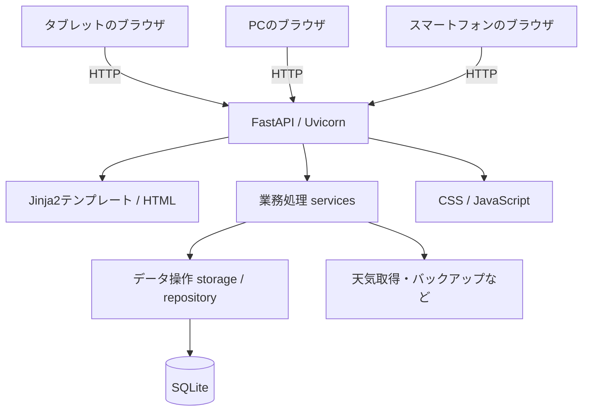
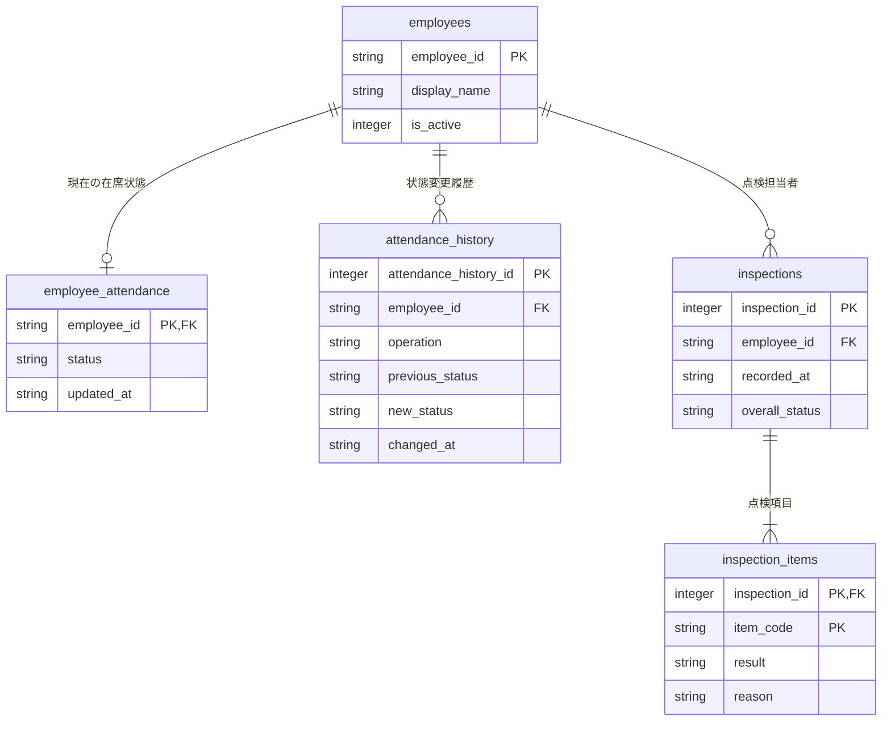

## はじめに

前回は、使わなくなった小型PCを開発機にして、事務所ではRaspberry Pi 3Bと古いタブレットを組み合わせるまでの経緯を紹介しました。

今回は少し中身に踏み込んで、Webアプリ「**office_terminal**」がどういう構造で動いているかを紹介します。

最初の目的は退室点検簿の電子化でしたが、作っていくうちに出社・在席管理、履歴、カレンダーなどが加わりました。そうなると、画面を増やすだけでは済まず、データの持ち方や処理の分け方も考える必要があります。

私はまず「何を実現したいか」を考え、AIとの対話で仕様や実装方法を具体化しながら開発しています。今回のコードも、最初からすべてを自分で書いたわけではありません。そのため、単にコードを並べるよりも、**なぜこの構成で動いているのかを自分なりに整理する**ことを意識して書きます。

なお、掲載するコードは公開用リポジトリの実装から抜粋しています。

https://github.com/techcraft-lab/office_terminal

## 1. ソフトウェアの全体構成

前回は開発用PC、Raspberry Pi、タブレットという機器側の構成を紹介しました。今回はアプリケーション内部の構成です。



主な使用技術は次のとおりです。

| 用途 | 使用技術 |
| --- | --- |
| サーバー側 | Python 3.11 / FastAPI / Uvicorn |
| HTML生成 | Jinja2 |
| 操作画面 | HTML / CSS / JavaScript |
| データ保存 | SQLite（Python標準の`sqlite3`） |
| Python環境管理 | uv |
| テスト | pytest |

ブラウザからの操作はFastAPIが受け付け、必要な業務処理を呼び出してSQLiteを更新します。画面はJinja2によるHTML表示を基本とし、在席一覧など一部の情報だけをJavaScriptで定期取得しています。

常にブラウザと通信し続ける複雑な仕組みにせず、今回の用途で必要なところに絞って更新する構成です。

## 2. ファイルを役割ごとに分ける

ソースコードの主要部分は、次のようになっています。

```text
src/office_terminal/
├── main.py                 # アプリ起動と初期化
├── web/
│   └── routes.py           # URLと画面・APIの対応
├── services/
│   ├── attendance_service.py  # 出退勤・在席の業務処理
│   ├── inspection_service.py  # 日次点検の検証・保存依頼
│   ├── calendar_service.py    # カレンダー生成
│   ├── weather_service.py     # 天気情報
│   └── backup_service.py      # バックアップ・復元
├── storage/
│   ├── database.py         # SQLite接続とテーブル定義
│   └── repository.py       # データベース読み書き
├── templates/              # HTMLテンプレート
└── static/
    ├── css/style.css
    └── js/app.js
```

※主要ファイルのみ抜粋しています。

ここで大切なのは、**URLを受け付ける部分、業務上の判断をする部分、データを保存する部分を分けていること**です。

例えば、点検結果が正しいかどうかを判断する処理までHTML内に入れてしまうと、画面を変更したときに影響が大きくなります。逆に、業務ルールをPython側に置けば、将来カードリーダーなど別の入力方法を追加する場合にも使い回しやすくなります。

## 3. FastAPIで画面とAPIを提供する

アプリの入口は`main.py`です。FastAPIを生成し、静的ファイルとルーティングを登録しています。

```python
application = FastAPI(title="事務所 退室点検端末", lifespan=lifespan)
application.state.database_path = resolved_database_path
application.mount(
    "/static",
    StaticFiles(directory=BASE_DIR / "static"),
    name="static",
)
application.include_router(router)
return application
```

出典：[main.py](https://github.com/techcraft-lab/office_terminal/blob/main/src/office_terminal/main.py) の`create_app()`から抜粋。

起動時にはSQLiteのテーブル初期化に加え、バックアップ管理や天気更新処理も準備します。バックアップは設定によって有効・無効を切り替える作りです。

一方、画面にアクセスしたときの処理は`web/routes.py`にまとめています。例えば点検画面の表示は、次のようなコードです。

```python
@router.get("/inspection", name="inspection")
async def inspection(request: Request):
    employees = repository.list_active_employees(database_path(request))
    return render_inspection(request, employees=employees)
```

出典：[routes.py](https://github.com/techcraft-lab/office_terminal/blob/main/src/office_terminal/web/routes.py)

この処理は、有効な社員一覧を取得して点検画面へ渡します。画面のHTMLそのものは`templates/inspection.html`にあります。

FastAPIで処理を受け取り、Jinja2に必要な値を渡して画面を表示する、という比較的素直な仕組みです。

## 4. SQLiteでは「現在の状態」と「履歴」を分けた

データベースにはSQLiteを採用しました。独立したDBサーバーを用意しなくても扱えるので、Raspberry Piで動かす今回のシステムに向いていると考えました。

主なテーブルは5つです。



※説明に必要なカラムのみ記載しています。

`employee_attendance`には社員ごとの**現在の状態**を、`attendance_history`には**状態変更の記録**を残します。

同様に、点検の基本情報を`inspections`、5項目それぞれの結果を`inspection_items`に分けています。

社員情報の定義は、実際に次のようになっています。

```sql
CREATE TABLE IF NOT EXISTS employees (
    employee_id TEXT PRIMARY KEY,
    display_name TEXT NOT NULL,
    is_active INTEGER NOT NULL DEFAULT 1 CHECK (is_active IN (0, 1))
);
```

出典：[database.py](https://github.com/techcraft-lab/office_terminal/blob/main/src/office_terminal/storage/database.py)

画面に表示する社員は`is_active = 1`の社員だけを取り出し、社員番号順に並べています。

また、データベースファイルの標準保存先は`~/.local/share/office_terminal/office_terminal.db`です。環境変数`OFFICE_TERMINAL_DB_PATH`で変更できるため、開発時には別のDBを使用できます。

## 5. 出退勤は状態遷移として扱う

画面には「出社」「離席」「戻り」「退勤」の4つの操作があります。ただし、データベースに保存する現在の状態は「在室」「離席中」「退勤済み」の3種類です。

例えば「出社」を押せば、退勤済みから在室に変わります。「戻り」は離席中のときだけ有効です。

このルールは`attendance_service.py`にまとめています。

```python
DEFAULT_STATUS = "退勤済み"
OPERATIONS = {
    "出社": (("退勤済み",), "在室"),
    "離席": (("在室",), "離席中"),
    "戻り": (("離席中",), "在室"),
    "退勤": (("在室", "離席中"), "退勤済み"),
}
```

出典：[attendance_service.py](https://github.com/techcraft-lab/office_terminal/blob/main/src/office_terminal/services/attendance_service.py)

こうして許可する状態遷移を決めておけば、退勤済みの社員がいきなり「戻り」を操作するような不正な変更を防げます。

さらに、現在の在席状態の更新と履歴の追加は、一つのSQLiteトランザクションで実行しています。途中でエラーが起きた場合に、現在の状態と履歴が食い違わないようにするためです。

通信トラブルで同じ操作が再送された際の二重登録対策として、UUIDの操作キーも利用しています。このあたりは出退勤機能を紹介する回で詳しく取り上げたいと思います。

## 6. 在席者一覧はJavaScriptで10秒ごとに更新

TOP画面には現在在室・離席中の社員一覧を表示しています。


ほかの社員がPCやスマートフォンから操作しても表示が更新されるよう、FastAPI側にJSONを返すAPIを用意しています。

```python
@router.get("/api/attendees", name="attendee_status_api")
async def attendee_status_api(request: Request):
    return list_current_attendees(database_path(request))
```

出典：[routes.py](https://github.com/techcraft-lab/office_terminal/blob/main/src/office_terminal/web/routes.py)

ブラウザ側の`app.js`では、次のようにFetch APIでデータを取得します。

```javascript
const response = await window.fetch("/api/attendees", {
  cache: "no-store",
  signal: controller.signal,
});
if (!response.ok) throw new Error(`HTTP ${response.status}`);
const data = await response.json();
renderAttendees(data);
```

出典：[app.js](https://github.com/techcraft-lab/office_terminal/blob/main/src/office_terminal/static/js/app.js) から抜粋。

実装では10秒ごとに取得し、通信エラーのときには現在表示中の一覧を残しながら、最新情報が取得できていない旨を表示します。

WebSocketのような常時接続方式ではなく定期的なHTTP通信ですが、今回の人数と用途では十分と考えています。

なお、同じような仕組みでカレンダー上の「出社記録がある日」の表示も更新しています。

## 7. 点検保存では入力チェックと整合性を重視

退室点検では、エアコン、窓の施錠、電灯、電気機器、全員退室の5項目を確認します。


「異常あり」「未実施」の場合は理由が必須です。これをブラウザ上だけのチェックにせず、サーバー側の`inspection_service.py`でも確認しています。

また「全員退室」を確認済みにしようとしても、点検者以外に在室・離席中の社員が登録されている場合は、そのまま保存できないようにしています。

点検の基本記録と5項目の結果は、同一トランザクションで保存します。さらに、二重送信防止のための冪等キーも使っています。

点検中の入力内容はブラウザの`localStorage`へ下書き保存します。ただし、これは正式な点検記録とは別物です。正式な記録はサーバー側で検証してSQLiteへ保存します。

こうした仕組みは、普段は目立ちません。しかし、毎日使う画面だからこそ、入力途中の中断や操作ミスも考慮しておきたいところです。

## 8. 作りながら分かったこと

「小さな社内ツールなら、そこまで設計にこだわらなくてもよいのでは」と考えることもありました。

ただ、点検、在席管理、履歴、カレンダーと機能が増えてくると、処理を役割ごとに分けておく意味が見えてきました。

例えば、点検フォームの見た目を変更することと、点検結果を正しく保存することは別の問題です。画面側だけでなくサーバー側でも検証するのは、そうした役割の違いがあるからです。

そして今回、自分にとって大きかったのは、**AIを使って動くものを作るだけでなく、実際のコードを読み直して構成や理由を理解していくこと**でした。

理解しきれていないところはまだありますが、実際に動くシステムがあると、「この処理はどこにあるのか」「なぜこのテーブルが必要なのか」といった疑問を具体的に調べられます。

若手社員にとっても、完成済みのサンプルを読むだけでなく、実際に使うシステムを少しずつ改善することが良い学習材料になるのではないかと思っています。

## まとめ

今回は`office_terminal`のソフトウェア構成を紹介しました。

- FastAPIで画面表示とAPIを担当する
- 業務処理とデータ保存の役割を分ける
- SQLiteでは現在の状態と履歴を分けて保持する
- 必要な表示だけをJavaScriptで定期更新する
- 操作ミスや二重送信を想定してサーバー側でも検証する

特別な技術を使っているわけではありませんが、身近な技術を組み合わせることで、日常業務で使える仕組みにできました。

次回は「出社・離席・戻り・退勤」の状態管理や履歴記録について、もう少し具体的な処理を紹介したいと思います。

### ソースコード

[techcraft-lab/office_terminal](https://github.com/techcraft-lab/office_terminal)

現状はログインや本人認証、厳密な権限管理を実装していません。社内LANでの限定利用を想定したもので、**インターネットへ直接公開する用途には適していません**。
